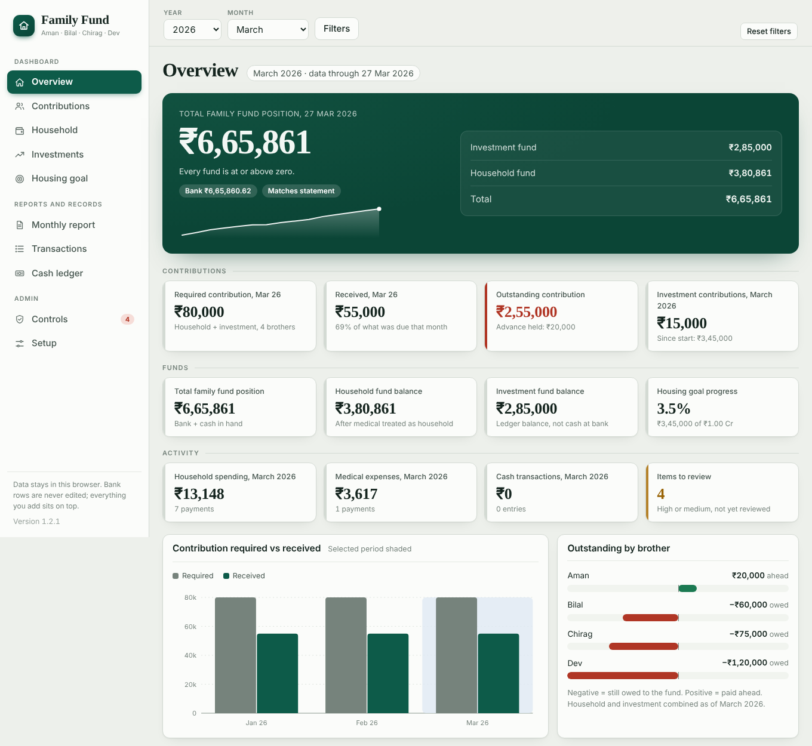
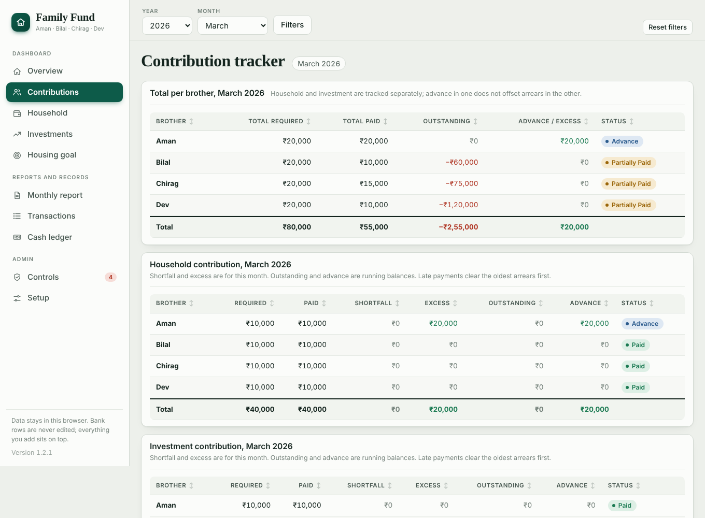
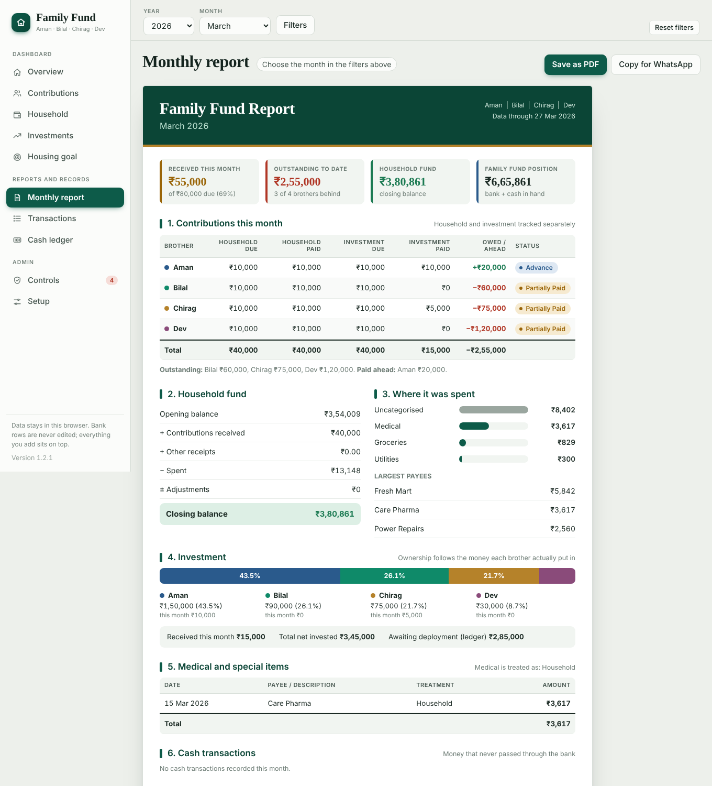

# Family Fund

A private dashboard for a family that pools money every month: household expenses, an investment pool and a long-term housing goal. You import your bank-statement workbook (Excel), and the app builds contribution tracking, fund balances, ownership percentages, a monthly report and a review list on top of it.

It is a **single static HTML file**. There is no server and no account. Your data is read in the browser and stays in that browser.



<details>
<summary>More screenshots</summary>





</details>

All screenshots use the synthetic workbook in `sample-data/`, not real figures.

## What it does

- **Contribution tracking.** Required against paid, per brother, per month, with running outstanding and advance balances. Targets come from a plan with effective-from months, so changing or suspending a contribution never rewrites history. Late, advance and catch-up payments are matched oldest-arrears-first.
- **Separate funds.** Household, investment, special and (optionally) a separate medical fund, each with an opening balance, movements and a closing balance that reconciles to the bank statement.
- **Investment ownership.** Each brother's share follows what he actually contributed. Payouts can be marked *deployed* or *returned to a brother*, which changes ownership only when money is returned.
- **Housing goal.** Progress, required monthly amount, pace against a straight line, projected completion date and a what-if table.
- **Cash ledger.** For money that never touches the bank. ATM withdrawals are itemised instead of counted twice, and entries that look like a bank row are flagged.
- **Categories without touching data.** Bank rows are read-only. Categories, payment modes, medical treatment, notes and category splits are stored as a separate layer that survives re-imports.
- **Controls.** Reconciliation checks, and a review list for duplicates, missing brothers or categories, negative balances, unexplained cash and more. Nothing is ever deleted or changed for you.
- **Monthly report.** On screen, as a PDF, or as text to paste into WhatsApp.

## Quick start

1. Open the app (see *Deploy* below, or open `dist/index.html` after `python build.py`).
2. Choose your workbook. It needs a sheet with these columns in one header row:

   | Date | Depositor | TransactionType | Purpose | Description | Amount |
   |---|---|---|---|---|---|

   - `Depositor` is a brother's name, the person who spends from the household account, or a bank label. You set all three under **Setup → Family members**.
   - `Purpose` drives the treatment: `Family Expenses`, `Investments`, `Medical Expense`, `Additional Expense`, `Internal Transfer`, `Bank Charges`.
   - Deposits are positive, withdrawals negative. A totals row is skipped. A cell next to the text `Bank Statement Balance` in the first rows is used for reconciliation.
3. Review the import summary and confirm.

To try it without real data, generate a synthetic workbook: `python sample-data/make_sample.py`.

## Install on a phone, use offline

Open the site in Safari (iPhone) or Chrome (Android) and choose **Add to Home Screen**. After the first visit it opens without internet. When a new version is published, the app shows **A new version is ready. Reload**.

## Run it on a PC with no internet

`python build.py --offline` also writes `dist/family-fund-offline.html`, one file with every library inlined. Copy it anywhere, double-click it and it opens in Chrome or Edge. It downloads the two libraries once into `vendor/` (git-ignored) if they are not there yet.

Data is saved in the browser for that file location, so keep the file in one place and use **Setup → Save backup** now and then.

## Privacy

- Nothing is uploaded. The workbook is parsed in the browser and saved in that browser's local storage.
- Use **Setup → Save backup** to keep a copy; use **Restore backup** to move to another device. Give the backup a password: it is then encrypted (AES-256) and unreadable without it. The password cannot be recovered. Backups without a password, including older ones, still restore.
- `.gitignore` blocks `*.xlsx`, `*.csv` and backup files so real data is not committed by accident. Only `sample-data/sample-workbook.xlsx` is allowed.
- SheetJS and jsPDF are bundled with the app (pinned versions, checked by fingerprint at build time), so nothing is loaded from a CDN. Only the two fonts come from Google Fonts; without them the app uses system fonts.
- A strict security policy stops the page from sending anything to any server.

## Development

Only Python is needed to build. Node is optional (used for a syntax check if present).

```bash
npm ci --ignore-scripts               # the two pinned libraries (or set LOCAL_VENDOR, or let build.py download them)
python build.py --offline             # dist/ (the website) and dist/family-fund-offline.html
pip install -r requirements-dev.txt
playwright install chromium
pytest -q                             # end-to-end tests: the app, and the website as GitHub Pages serves it
python tests/crawl.py                 # whole-app check: every page, button, dialog and box, desktop and phone
python scripts/screenshots.py         # refresh docs/screenshots
```

```
src/
  core.js       constants, formatting, state, workbook import
  engine.js     classification, contributions, funds, goal, exceptions, controls
  charts.js     small SVG chart kit with tooltips
  views1.js     filters, overview, contribution tracker
  views2.js     household, investments, housing goal, monthly report, transactions
  views3.js     cash ledger, controls, setup, edit dialogs
  pdf.js        PDF report
  main.js       navigation, events, import, sorting, backup (optionally encrypted)
  pwa.js        offline support registration and the "new version" prompt
  sw.js         offline cache (build.py fills in the version and file list)
  icons/, manifest.webmanifest   Home Screen install
  style.css     design tokens and components
  fontdata.js   Roboto subset (rupee sign) for the PDF, see scripts/make_font_subset.py
sample-data/    synthetic workbook generator
tests/          Playwright + pytest end-to-end tests, and crawl.py (whole-app check)
```

`build.py` takes the libraries from `LOCAL_VENDOR`, `node_modules/` or `vendor/`, or downloads them once, and stops if a file does not match its pinned SHA-256.

## Deploy (GitHub Pages)

`.github/workflows/ci.yml` runs every test and the whole-app check on every push and pull request. On `main`, if all of them pass, it publishes `dist/`. A failing test means the site stays on the previous version.

1. Push the repository to GitHub.
2. **Settings → Pages → Build and deployment → Source: GitHub Actions**.
3. The site appears at `https://<user>.github.io/<repo>/`.

Pages sites are public, even when the repository is private, unless your plan supports private Pages. The site contains no data and no real names: it starts with made-up names (Aman, Bilal, Chirag, Dev). Enter your family's names under **Setup → Family members**; they are saved in your browser only, and in your backups. You can also skip Pages and just open `dist/index.html` from a file.

## Known limits

- Data lives in one browser. Multi-device sharing is not built in.
- The PDF and most figures assume Indian rupee formatting.
- Categories are one level deep plus subcategories; a split changes the category of a payment, not its fund.

## Licence

MIT. Third-party notices are in `NOTICE.md`.
